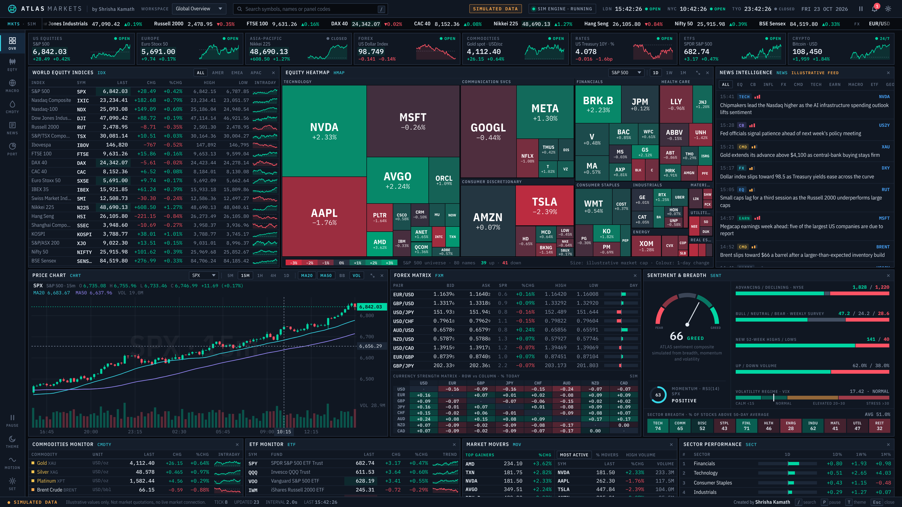
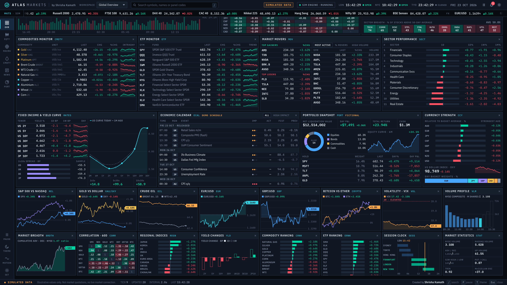

# ATLAS MARKETS

A trading-terminal style market dashboard, inspired by the Bloomberg Terminal and institutional trading desks. Created by [Shrisha Kamath](https://www.linkedin.com/in/shrishakamath/).

**Live demo: [shrishaskamath.github.io/atlas-markets](https://shrishaskamath.github.io/atlas-markets/)**

## What's on screen

- **Equity heatmap** of 80 large caps grouped by sector, switchable between S&P 500, Nasdaq-100, mega caps and the price-weighted Dow 30, with 1D / 1W / 1M views
- **Candlestick chart** with MA20, MA50, Bollinger Bands, volume, crosshair and five timeframes
- **FX matrix** with bid/ask, spreads in pips and a currency strength grid; crosses are derived from the majors and the Dollar Index is calculated from its basket weights
- **Rates**: US yield curve against one month ago, 2s10s spreads for the US, UK, Germany and Japan, moves in basis points
- **Sentiment and breadth**: composite gauge from breadth, RSI momentum and the VIX regime, plus sector breadth
- **World indices, commodities, ETFs, market movers and cap-weighted sector performance**
- **Economic calendar** in London time, an impact-tagged news feed and a portfolio snapshot that reprices with every tick
- **16 compact panels**: correlations, volatility, volume profile, breadth, session clock and more
- Symbol search, desk workspaces, pause, light/dark theme and a reduced-motion mode

## Data

Every price, headline, calendar entry and portfolio figure is **simulated in the browser**. A small engine moves prices with a shared market factor and dollar factor plus mean reversion, so related instruments move together plausibly. Nothing is connected to an exchange, broker or news service, and nothing here is investment advice.

## How it was built

Designed by Shrisha Kamath and built with an AI coding assistant. It is a single self-contained HTML file (`index.html`) with no build step or backend.
